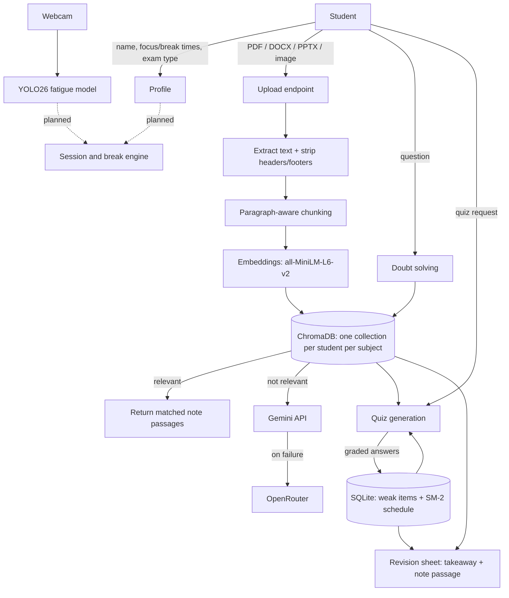

# AI Study Buddy

An adaptive study companion for students, designed with ADHD in mind. It answers doubts from the student's own notes, quizzes them on what they uploaded, builds a last-minute revision sheet from what they got wrong, and uses a webcam-based fatigue detector to know when a break is due.

## Contents

1. [Why this project](#why-this-project)
2. [Features](#features)
3. [Architecture](#architecture)
4. [Tech stack](#tech-stack)
5. [Project structure](#project-structure)
6. [Setup](#setup)
7. [Running it](#running-it)
8. [API reference](#api-reference)
9. [How each part works](#how-each-part-works)
10. [Fatigue detection model](#fatigue-detection-model)
11. [Design decisions](#design-decisions)
12. [Known limitations](#known-limitations)
13. [Roadmap](#roadmap)
---

## Why this project

Students with ADHD often struggle with four things while studying: getting started, noticing when their attention has faded, knowing when to rest, and deciding what to prioritise before an exam. Existing tools tend to solve one slice of this:

- focus timers use fixed intervals and know nothing about the student
- distraction blockers watch which app is open, not the student
- flashcard generators know the content but not the student's state

This project combines the slices in one loop: **notes → doubts → quiz → revision**, with a **physiological fatigue signal** deciding when to rest. The aim is not to claim a new algorithm. The contribution is the integration, plus evidence-based defaults (retrieval practice and spaced repetition) instead of self-reported "learning styles".

## Features

| Feature | What it does |
|---|---|
| **Onboarding profile** | Stores the student's focus time, break time, exam type (objective / subjective / mixed) and question style. Name only, no password. |
| **Multi-format notes upload** | PDF, DOCX, PPTX, JPG and PNG. Headers, footers and page numbers are stripped before chunking. |
| **Meaningful chunking** | Splits by paragraph, then sentence, rather than cutting at a fixed character count. |
| **Doubt solving (RAG)** | If the question is covered by the notes, returns the matching passages with no LLM call. Otherwise answers from general knowledge via Gemini, with OpenRouter as a fallback, and labels the answer's source. |
| **Quiz generation** | Objective (4-option MCQs, graded by code) or subjective (graded 0-5 by an LLM against key points). Question style comes from the profile. |
| **Revision sheet** | Missed questions are scheduled with SM-2 spaced repetition. The sheet shows each weak point with an AI takeaway on top and the matching passage from the notes underneath. |
| **Fatigue detection** | A YOLO26 model detects `microsleep`, `neutral` and `yawning` from the webcam. Sustained signs trigger a drowsy alert, and repeated signs over time raise a "tired" flag. |

## Status

| Part | State |
|---|---|
| Fatigue model (training, evaluation, live inference) | Working |
| Notes ingestion and doubt solving | Working |
| Quiz generation, revision sheet, profiles | Working (End-to-end tested & verified) |
| Session timer and break suggestions | Working (Adaptive Pomodoro & fatigue alerts) |
| Badges and encouragement | Working (9 badges, SQLite tracking) |
| Web frontend | Working (Cyberpunk Neural HUD web app) |
| Camera → web app connection | Working (/detect-focus-frame integration) |

## Architecture



Solid arrows are built. Dotted arrows are planned.

## Tech stack

| Area | Tools |
|---|---|
| Backend | Python, FastAPI, Uvicorn |
| Notes extraction | pypdf, python-docx, python-pptx, Pillow + pytesseract (OCR) |
| Retrieval | sentence-transformers (`all-MiniLM-L6-v2`), ChromaDB |
| LLMs | Google Gemini API (`gemini-flash-latest`), OpenRouter (`openrouter/free`) as fallback |
| Storage | ChromaDB (notes), SQLite (profiles, weak items) |
| Fatigue detection | Ultralytics YOLO26, OpenCV |
| Planned frontend | Next.js, Tailwind CSS |

## Project structure

The backend files import each other directly, so keep them in the same folder.

```
study-buddy/
├── backend/
│   ├── api.py                 # FastAPI app: all endpoints
│   ├── profiles.py            # name-only profiles, per-student subject scoping
│   ├── ingest_notes.py        # extract -> clean -> chunk -> embed -> store
│   ├── doubt_solving.py       # retrieval, answer-from-notes, Gemini/OpenRouter fallback
│   ├── quiz_generation.py     # quiz generation and grading
│   ├── revision.py            # SM-2 scheduling and revision sheet
│   ├── llm_utils.py           # shared Gemini -> OpenRouter JSON helper
│   └── .env                   # API keys (never commit this)
└── fatigue_detection/
    ├── data.yaml              # dataset config (3 classes)
    ├── train_drowsiness.py    # trains YOLO26
    ├── evaluate_model.py      # test-set metrics
    ├── check_overfitting.py   # compares train / val / test performance
    ├── live_inference.py      # webcam demo with drowsy alert and tired score
    └── best.pt                # trained weights
```

Generated at runtime: `chroma_store/` (vector database) and `study_buddy.db` (SQLite).

## Setup

### 1. Python version

Python 3.11 or 3.12 is recommended, especially for the OpenCV / YOLO part. OpenCV's prebuilt packages did not work reliably on Python 3.14 during development.

```bash
py -3.11 -m venv .venv
.venv\Scripts\activate
```

### 2. Install dependencies

```bash
# Backend
pip install fastapi uvicorn python-multipart
pip install pypdf python-docx python-pptx pillow pytesseract
pip install chromadb sentence-transformers
pip install google-genai openai python-dotenv

# Fatigue detection
pip install ultralytics opencv-python
```

**Image uploads (JPG / PNG)** also need the Tesseract OCR engine installed on your system. `pytesseract` is only a wrapper. On Windows, install Tesseract and add its folder to your PATH. PDF, DOCX and PPTX uploads work without it.

### 3. API keys

Create a file named `.env` in the `backend/` folder:

```
GEMINI_API_KEY=your-gemini-key
OPENROUTER_API_KEY=your-openrouter-key
```

- Gemini key: https://aistudio.google.com/apikey
- OpenRouter key: https://openrouter.ai

Either key alone is enough. If the Gemini call fails, the app falls back to OpenRouter. Add `.env` to `.gitignore`.

## Running it

### Backend

```bash
cd backend
uvicorn api:app --reload
```

Open http://localhost:8000/docs for the interactive API page.

### Typical walkthrough in `/docs`

1. `POST /profile`: create yourself (for example 25 focus minutes, 5 break minutes, `mixed`, `theory`).
2. `POST /upload-notes`: upload a file with the same name and a subject such as `Machine Learning`.
3. `POST /ask-doubt`: ask something covered by the notes, then something that isn't, and compare the `source` field.
4. `POST /generate-quiz`, then `POST /submit-quiz` with your answers. Miss a few on purpose.
5. `GET /revision-sheet`: see your weak points. Generate another quiz and check `review_questions`.

### Fatigue detection

```bash
cd fatigue_detection
python live_inference.py      # webcam demo, press q to quit
python evaluate_model.py      # test-set metrics
python check_overfitting.py   # train vs val vs test comparison
```

### Terminal test scripts

Most backend modules can also be run directly for quick tests. Edit the variables at the top of each file first: `ingest_notes.py`, `doubt_solving.py`, `quiz_generation.py`, `revision.py`, `profiles.py`. These use plain subject names and are not tied to a profile.

## API reference

| Method | Endpoint | Purpose |
|---|---|---|
| POST | `/profile` | Create or update a profile (`name`, `focus_minutes`, `break_minutes`, `exam_type`, `question_style`) |
| GET | `/profile?user_name=` | Read a profile |
| POST | `/upload-notes` | Upload notes (`file`, `user_name`, `subject_name`) |
| POST | `/ask-doubt` | Ask a question (`user_name`, `subject_name`, `question`). Returns `answer` and `source` (`from_notes` or `general_knowledge`) |
| POST | `/generate-quiz` | Create a quiz (`user_name`, `subject_name`, optional `quiz_type`, `num_questions`, `topic`, `style`). Blank type and style come from the profile |
| POST | `/submit-quiz` | Grade a quiz (JSON: `quiz_id`, `answers`). Objective answers are option indexes 0-3, subjective answers are text |
| GET | `/revision-sheet?user_name=&subject_name=` | The student's weak points with takeaways and note passages |

Every endpoint except `/profile` requires an existing profile for that name.

## How each part works

### Notes ingestion (`ingest_notes.py`)

| Format | How text is extracted | Headers / footers |
|---|---|---|
| PDF | pypdf, page by page | Lines repeating across most pages are detected and removed, plus standalone page-number lines |
| DOCX | python-docx body and tables | Never read (stored separately in the file format) |
| PPTX | python-pptx text shapes | Slide-number, footer and date placeholders are skipped |
| JPG / PNG | Tesseract OCR | Not applicable |

Chunking groups whole paragraphs up to about 500 characters, falls back to sentences for long paragraphs, and carries about 100 characters of overlap from the previous chunk. Each chunk is embedded and stored in ChromaDB.

### Per-student separation

Notes, quizzes and weak points are scoped with a combined name such as `anusree__machine-learning`. Because every module already takes a subject name, no student's data mixes with another's. Names are case and spacing insensitive.

### Doubt solving (`doubt_solving.py`)

1. Embed the question and retrieve the top 4 chunks.
2. If the best match is close enough (distance threshold 1.0), return those passages directly. No LLM call, no paraphrasing risk, no cost.
3. Otherwise ask Gemini for a general-knowledge answer. If that fails, ask OpenRouter.
4. Always return the `source` so the interface can show "From your notes" or "General knowledge, not in your notes".

### Quizzes (`quiz_generation.py`)

- Questions are written only from notes sampled across the subject (or around a chosen topic).
- **Objective:** four options, one correct. Options are shuffled in code because LLMs tend to favour certain positions. Graded by comparison, no LLM.
- **Subjective:** the model writes a question, an ideal answer and key points. Student answers are graded 0-5 against the key points in one batched call. Blank answers score 0 without a call. Scores are labelled approximate.
- Up to a third of each quiz is questions the student missed before and that are due for review.
- The correct answers stay on the server until the quiz is submitted.

### Revision sheet (`revision.py`)

- A missed question becomes a weak item and is due again immediately, so it returns in the next quiz.
- Scheduling follows SM-2: a pass pushes the gap out (1 day, then 6, then multiplied by an ease factor), a fail resets it.
- Objective quality is 4 for correct and 1 for wrong. Subjective quality is the 0-5 score.
- An item passed three times in a row is considered mastered and drops off the sheet.
- Questions answered correctly the first time never enter the sheet.
- Each entry shows an AI takeaway (generated once and cached) above the best-matching passage from the notes. If both LLMs fail, the sheet still shows the passages.

## Fatigue detection model

### What it detects

The model detects **fatigue cues**, not "focus". It was trained as an object detector with three classes: `microsleep`, `neutral`, `yawning`. Detecting attention itself from a face is not reliable, so the project deliberately frames this as drowsiness detection.

### Training

| Item | Value |
|---|---|
| Model | YOLO26 nano detection (`yolo26n.pt`) |
| Task | Object detection, YOLO annotation format (`images/` and `labels/` per split) |
| Classes | 3: microsleep, neutral, yawning |
| Splits | train / valid / test |
| Epochs, image size, batch | 50, 640, 16 |
| Hardware | Trained on a GPU laptop, then run locally on CPU for inference |
| Dataset source | _Add the dataset name, link and license here_ |

### Results

Filled from `evaluate_model.py` and `check_overfitting.py` evaluation runs:

| Split | mAP50 | mAP50-95 | Precision | Recall |
|---|---|---|---|---|
| Train | 0.991 | 0.824 | 0.950 | 0.942 |
| Validation | 0.975 | 0.795 | 0.937 | 0.928 |
| Test | 0.984 | 0.809 | 0.936 | 0.929 |

Overfitting was checked by comparing performance across the three splits. The original training logs (`results.csv`) were not kept, so the per-epoch curves are not available.

### Turning detections into alerts (`live_inference.py`)

A single detection is not treated as fatigue. Two layers sit on top of the detector:

- **Drowsy alert:** a fatigue class must appear for 45 consecutive frames (about 1.5-2 seconds) before an alert is shown. This filters out blinks and single-frame mistakes.
- **Tired flag:** each new yawn or microsleep counts as one event. Four or more events in a rolling 5-minute window raises the flag. These two thresholds are starting guesses and should be tuned on real study sessions.

## Design decisions

| Decision | Reasoning |
|---|---|
| Retrieval practice and spaced repetition as the core mechanism | Strongly supported by research. Quizzing beats re-reading even though it feels harder. |
| YOLO detection | YOLO route supports yawning and microsleep from one model. |
| In-notes answers return raw passages | Zero cost, zero paraphrasing risk, and stays strictly grounded in the student's material. |
| Gemini first, OpenRouter second | Direct Gemini is faster and cheaper. OpenRouter keeps the app working if Gemini is rate limited or down. |
| Source labelling on every answer | Students must know whether an answer came from their notes or from general knowledge, since their course may teach a specific version. |
| User-triggered flow | The app suggests, the student decides. Study, quiz and revision are never forced. |
| Name-only profiles | Fastest option for a demo. Real login is deferred. |
| Subjective scores labelled approximate | AI grading against key points is useful but not a trustworthy substitute for a teacher. |

## Known limitations

- **Fatigue is not focus.** The model sees drowsiness cues. Someone reading intently can look still and quiet, and someone distracted can look alert.
- **No real authentication.** Anyone who types a name can open that profile.
- **The relevance threshold is untuned.** The distance value (1.0) decides "in the notes" versus "general knowledge" and should be tuned with real questions.
- **Slide-style notes are hard to quiz from.** Short, fragmented slide text can produce weak questions. Larger chunks for quizzes may help.
- **Subjective grading is approximate** and depends on the LLM.
- **LLM free tiers have rate limits,** and free model availability changes over time.
- **Webcam privacy.** Sending camera frames to a server means video leaves the browser. Running everything locally avoids this, but a deployed version would need on-device inference.

## Roadmap

1. **Session and break engine:** a timer from the profile's focus and break times, plus early break suggestions from the drowsy alert and tired flag, with a cooldown so it does not nag.
2. **Camera → web app:** either a `/detect-frame` endpoint receiving browser frames, or an ONNX export running in the browser.
4. **Next.js frontend:** onboarding, upload, doubt chat, quiz screen, revision sheet and webcam view.
5. **Real authentication** and persistent quiz storage.
6. **Evaluation:** compare fatigue-triggered breaks against fixed-interval breaks on session completion and quiz retention.

## Author

Built by Anusree, Robotics and AI engineering, Amrita School of Engineering, as a machine learning course project.
